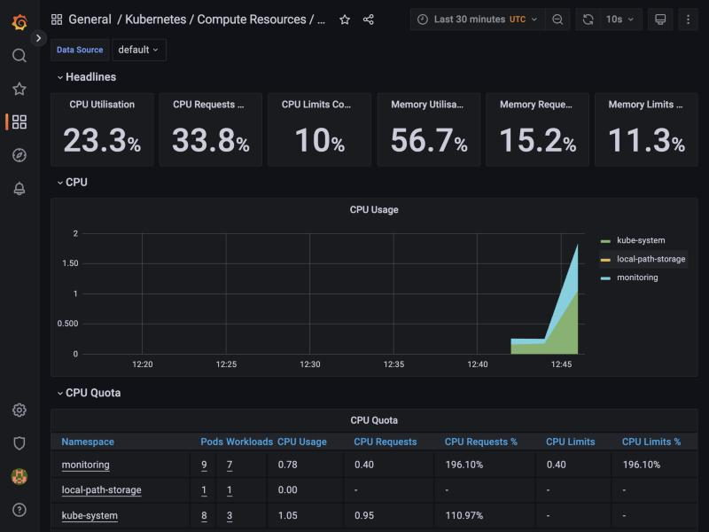
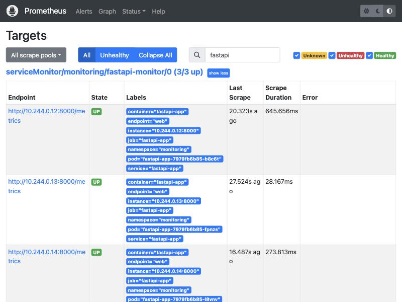
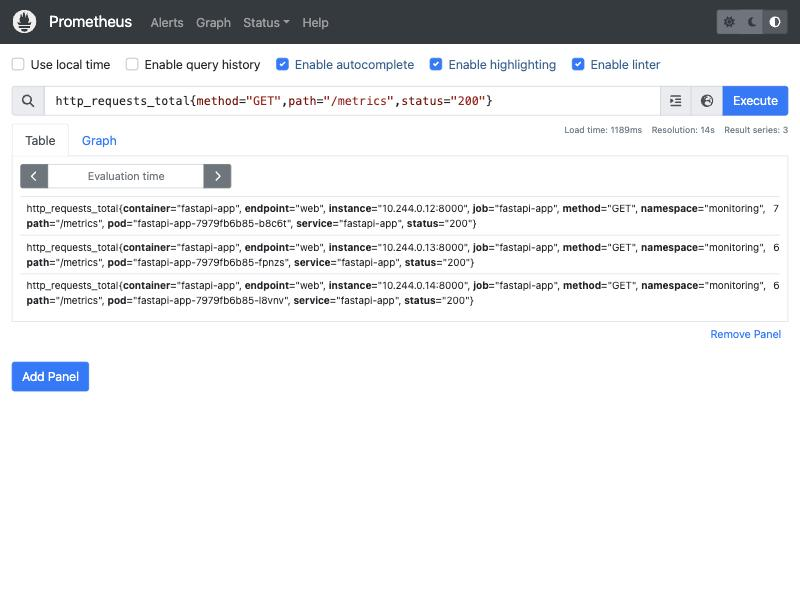
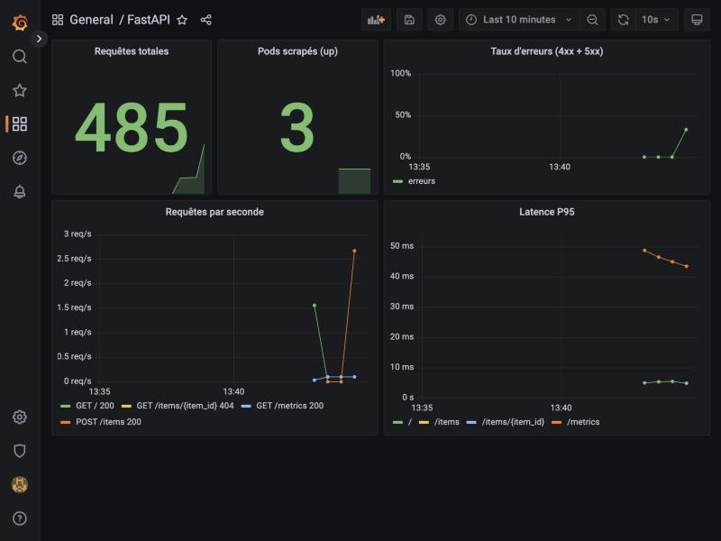

# Rapport : rendu du TP7

Tout a tourné sur un cluster kind à un seul nœud (Kubernetes 1.37), lancé avec Podman sur un Mac.

## Installation de la stack

Chart `kube-prometheus-stack` en version 45.7.1, comme dans les consignes. Elle date de 2023 mais s'installe sans erreur sur Kubernetes 1.37. Une minute après le `helm install`, les six pods tournent :

```
alertmanager-prometheus-kube-prometheus-alertmanager-0   2/2     Running
prometheus-grafana-685d7d4595-hcd52                      3/3     Running
prometheus-kube-prometheus-operator-7c8865ccf-xxxwc      1/1     Running
prometheus-kube-state-metrics-67b76c9bb4-4fvkc           1/1     Running
prometheus-prometheus-kube-prometheus-prometheus-0       2/2     Running
prometheus-prometheus-node-exporter-kkgcx                1/1     Running
```

## Monitoring du cluster

`kube_pod_container_status_running` renvoie `1` pour les 19 conteneurs du cluster, ceux de `kube-system` compris.

Dans Status > Targets, trois jobs restent `down` : `kube-controller-manager`, `kube-scheduler` et `kube-etcd`. C'est attendu sur kind, où ces composants n'écoutent que sur `127.0.0.1` dans le nœud et ne sont donc pas joignables par Prometheus. Pour les voir, il faudrait changer leur `bind-address` dans la config kind. Je ne l'ai pas fait, le TP n'en a pas besoin.

Côté Grafana, le login `admin` / `prom-operator` fonctionne (c'est aussi ce que contient le secret). Le chart crée 26 dashboards, dont ceux des nœuds, des pods et des namespaces :



## Monitoring de l'API FastAPI

J'ai repris l'image du TP6. Elle n'est sur aucun registre, alors je l'ai construite avec Podman et chargée dans le nœud kind avec `kind load image-archive` (commandes dans le README).

Les manifestes sont dans `k8s/`. Le Deployment et le Service reprennent ceux des consignes. Le ServiceMonitor, lui, ne marchait pas tel quel : il sélectionne `app: fastapi` alors que le Service porte `app: fastapi-app`. Avec le label des consignes, Prometheus ne trouve aucun Service et aucune target n'apparaît, sans message d'erreur nulle part. J'ai corrigé le sélecteur.

Après correction, les trois pods sont `UP` environ 30 secondes après le `kubectl apply` :



La requête demandée renvoie une série par pod, parce que Prometheus scrape chaque pod séparément et ajoute les labels `pod`, `instance` et `service` :



## Dashboard Grafana

Plutôt que de cliquer dans l'interface, j'ai mis le dashboard dans un ConfigMap (`k8s/grafana-dashboard.yaml`). Le chart installe un sidecar dans le pod Grafana qui surveille les ConfigMaps portant le label `grafana_dashboard: "1"` et les charge à chaud. Le dashboard est donc recréé si on réinstalle tout.

| Panel                 | Requête PromQL |
| --------------------- | -------------- |
| Requêtes totales      | `sum(http_requests_total{job="fastapi-app"})` |
| Pods scrapés          | `sum(up{job="fastapi-app"})` |
| Taux d'erreurs        | `(sum(rate(http_requests_total{job="fastapi-app",status=~"[45].."}[1m])) or vector(0)) / sum(rate(http_requests_total{job="fastapi-app"}[1m]))` |
| Requêtes par seconde  | `sum by (method, path, status) (rate(http_requests_total{job="fastapi-app"}[1m]))` |
| Latence P95           | `histogram_quantile(0.95, sum by (le, path) (rate(http_request_duration_seconds_bucket{job="fastapi-app"}[5m])))` |

Les `sum` sont nécessaires parce qu'il y a trois réplicas : sans eux, chaque courbe est découpée en trois séries, une par pod. Le taux d'erreurs compte cette fois les 4xx, puisque le trafic de test fait exprès des `GET /items/9999` qui renvoient 404.

Capture prise pendant le trafic généré avec une boucle curl :



## Questions

### 1. Pourquoi Helm simplifie-t-il Kubernetes ?

La stack installée ici, c'est plusieurs dizaines d'objets : Deployments, StatefulSets, Services, CRDs, RBAC, ConfigMaps, secrets. Helm les livre en un seul paquet versionné et les installe avec une commande. On règle le tout avec un fichier `values.yaml` au lieu de modifier les manifestes un par un, et la release se met à jour (`helm upgrade`), revient en arrière (`helm rollback`) ou se supprime d'un bloc. Le `--version 45.7.1` garantit aussi que tout le monde installe exactement la même chose.

### 2. Quelle différence entre Node Exporter et kube-state-metrics ?

Node Exporter tourne en DaemonSet, un pod par nœud, et lit l'état de la machine dans `/proc` et `/sys` : CPU, RAM, disque, réseau. Il ne connaît rien de Kubernetes.

kube-state-metrics est un seul pod qui interroge l'API Kubernetes et traduit l'état des objets en métriques : nombre de réplicas voulus et disponibles, phase des pods, redémarrages des conteneurs. `kube_pod_container_status_running` vient de lui. Il dit si un pod tourne, pas combien de CPU il consomme.

### 3. Pourquoi le label `release: prometheus` est-il obligatoire ?

L'objet Prometheus créé par le chart a un `serviceMonitorSelector` qui vaut `{"matchLabels":{"release":"prometheus"}}` (vérifié avec `kubectl get prometheus -n monitoring -o yaml`). L'opérateur ne prend que les ServiceMonitors qui ont ce label et ignore les autres sans prévenir. Ça évite qu'un Prometheus récupère les ServiceMonitors destinés à un autre quand plusieurs tournent dans le cluster. La valeur `prometheus` vient du nom de la release Helm ; avec `helm install monitoring ...`, il faudrait `release: monitoring`.

### 4. Que se passe-t-il si `/metrics` n'existe pas ?

L'app répond 404 au scrape. La target passe `DOWN` dans Status > Targets avec l'erreur `server returned HTTP status 404 Not Found`, `up` vaut 0 pour ce pod et aucune métrique de l'app n'est stockée. Les panels Grafana affichent « No data ». L'application, elle, continue de répondre normalement, ce qui rend la panne facile à rater sans alerte sur `up == 0`.

### 5. Quelle est la différence entre Prometheus et Grafana ?

Prometheus va chercher les métriques (scrape), les stocke dans sa base de séries temporelles, répond aux requêtes PromQL et évalue les règles d'alerte. Grafana ne stocke rien : il envoie des requêtes à Prometheus, ou à une autre source, et dessine les résultats. Sans Prometheus, Grafana n'a rien à afficher. Sans Grafana, Prometheus continue de collecter et d'alerter, avec une interface graphique beaucoup plus pauvre.
